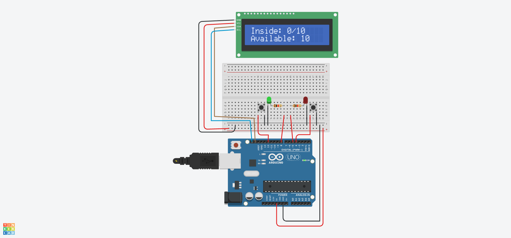

# Programming C Summative Assessment

This repository contains five projects developed for the C Programming Summative Assessment. The projects demonstrate C programming, shell scripting, Arduino programming, dynamic memory allocation, pointers, structures, function pointers, callback functions, file handling, searching, sorting, POSIX threads, system monitoring, validation, and error handling.

## Author

**Helen Okereke**

## Repository

[Programming_C_Summative](https://github.com/helen751/Programming_C_Summative)

## Project Structure

```text
Programming_C_Summative/
├── access_control/
│   └── access.ino
├── system_health/
│   ├── health.sh
│   ├── activity.log
│   └── downloads/
├── student_performance/
│   ├── main.c
│   └── students.dat
├── sales_analysis/
│   ├── main.c
│   ├── products.txt
│   └── transactions.txt
├── document_analyzer/
│   ├── main.c
│   ├── document1.txt
│   ├── document2.txt
│   ├── document3.txt
│   ├── document1_report.txt
│   ├── document2_report.txt
│   └── document3_report.txt
├── utils.h
└── CMakeLists.txt
```

## Project 1: Smart Occupancy Monitoring and Access Control System

### Overview

This project is an Arduino-based occupancy monitoring system for Helen's House. It records people entering and leaving, prevents the occupancy from exceeding the maximum capacity, and displays the current occupancy and available space on a 16x2 I2C LCD.

The maximum occupancy is set to 10 people.

### Hardware Components

- Arduino Uno
- Two push buttons
- Green LED
- Red LED
- Current-limiting resistors
- 16x2 I2C LCD
- Breadboard
- Jumper wires

### Pin Connections

- Entry button: digital pin 12
- Exit button: digital pin 4
- Green LED: digital pin 8
- Red LED: digital pin 5
- LCD SDA: Arduino SDA or A4
- LCD SCL: Arduino SCL or A5
- LCD VCC: 5V
- LCD GND: ground

### Main Features

- Displays a welcome message for Helen's House.
- Increases the occupancy when the entry button is pressed.
- Decreases the occupancy when the exit button is pressed.
- Prevents the occupancy from exceeding 10.
- Prevents the occupancy from becoming negative.
- Displays the current occupancy and available capacity.
- Keeps the green LED on while space is available.
- Keeps the red LED steadily on when full.
- Blinks the `FULL` and `No Space!` LCD message at maximum capacity.
- Rejects an entry attempt when the facility is full.
- Rejects an exit attempt when the facility is empty.
- Detects simultaneous entry and exit button presses.
- Displays events, errors, and statistics through the Serial Monitor.

### C and Arduino Concepts

The program uses structures to store occupancy and button information. The occupancy record is allocated dynamically with `malloc()` and accessed through a pointer. Allocation is checked before the record is used, and a cleanup function uses `free()`.

Button debouncing, LCD updates, the welcome period, and the full-capacity message use `millis()` instead of blocking delays.

### Running the Project

The circuit and program are designed to run in Tinkercad Circuits with the Arduino Uno and the Adafruit LiquidCrystal library.


The Arduino source file is:

```text
access_control/access.ino
```

---

## Project 2: Linux System Health and Resource Monitoring Manager

### Overview

This project is an interactive Bash application for monitoring system health and managing running processes. It supports Linux and includes macOS-compatible alternatives for the main monitoring operations.

### Main Features

- Displays hostname, operating system, kernel version, uptime, date, and time.
- Calculates current CPU utilization.
- Displays processes using the most CPU.
- Accepts and validates a CPU warning threshold.
- Displays total, used, and available memory.
- Calculates memory utilization as a percentage.
- Accepts and validates a memory warning threshold.
- Displays mounted filesystems and disk utilization.
- Identifies filesystems approaching their storage capacity.
- Accepts and validates a disk warning threshold.
- Displays running processes.
- Searches for processes by PID or name.
- Displays PID, owner, command, CPU usage, memory usage, and elapsed time.
- Supports safe process termination.
- Requests confirmation before terminating a process.
- Protects important system processes and processes belonging to other users.
- Generates timestamped system health reports.
- Saves reports in a directory selected by the user.
- Records operations, warnings, errors, and process actions in an activity log.
- Allows the activity log to be displayed or cleared after confirmation.

### Menu Operations

```text
1. Display System Information
2. Monitor CPU Utilization
3. Monitor Memory Utilization
4. Monitor Disk Utilization
5. View and Search Running Processes
6. Terminate a Process
7. Generate System Health Report
8. View Activity History
9. Clear Activity Log
0. Exit
```

### Commands and Shell Concepts

The script uses reusable functions, variables, arrays, loops, conditionals, command substitution, input validation, and exit-status checking.

Commands used include:

- `hostname`
- `uname`
- `uptime`
- `date`
- `top`
- `free`
- `vm_stat`
- `sysctl`
- `df`
- `ps`
- `sort`
- `awk`
- `grep`
- `head`
- `tail`
- `kill`
- `mkdir`
- `printf`

### Running the Project

```bash
cd system_health
chmod +x health.sh
./health.sh
```

The activity log is stored as:

```text
system_health/activity.log
```

Generated reports are stored in the directory selected while running the application.

---

## Project 3: Student Academic Records and Performance Analytics System

### Overview

This project is a menu-driven C application for managing student details, registered courses, marks, and academic performance. Student and course records are stored dynamically and saved in a binary file.

### Student Information

Each student record contains:

- Unique student ID
- First name
- Last name
- Programme
- Year of study
- Number of registered courses
- Dynamically allocated course records

### Course Information

Each registered course contains:

- Course code
- Course name
- Mark obtained
- Maximum mark

### Main Features

- Registers new students.
- Rejects duplicate student IDs.
- Displays all registered students.
- Displays the complete details of one student.
- Updates student information.
- Deletes students and releases their course memory.
- Adds courses from a predefined course catalogue.
- Prevents duplicate course registration.
- Updates a student's course mark.
- Validates marks against the course maximum.
- Displays individual academic performance.
- Searches by student ID, name, or programme.
- Sorts by ID, name, academic average, programme, or year of study.
- Generates a complete academic report.
- Saves students and nested course records in a binary file.
- Reconstructs dynamic student and course records when loading.

### Academic Report

The report includes:

- Total number of registered students
- Total number of registered courses
- Overall academic average
- Number of passing students
- Number of failing students
- Number of students without courses
- Highest-performing student
- Lowest-performing student
- Average performance per course
- Number of students in each programme

A course is considered passed when the student obtains at least 50 percent of its maximum mark.

### Searching and Sorting

Searching is implemented manually and is case-insensitive for text values.

Sorting uses the bubble sort algorithm without `qsort()`. A temporary copy of the student array is sorted and displayed, leaving the saved record order unchanged.

### Dynamic Memory

- `calloc()` allocates loaded student records.
- `malloc()` allocates loaded course records.
- `realloc()` expands or shrinks student and course arrays.
- Pointers access and update original student and course records.
- `free()` releases every student course array and the main student array.

### File Storage

Student records are stored in:

```text
student_performance/students.dat
```

### Compiling and Running

```bash
cd student_performance
gcc -std=c11 -Wall -Wextra -Wpedantic main.c -o student_performance_app
./student_performance_app
```

---

## Project 4: Sales Transaction Processing and Analysis System

### Overview

This project is a menu-driven C application for recording, managing, searching, sorting, filtering, and analysing sales transactions for Helen Stores.

Products are loaded from a text file. The user selects a product instead of entering its name and price manually. The selected product's price is used to calculate the transaction total.

### Transaction Information

Each transaction contains:

- Unique transaction ID
- Product name
- Quantity sold
- Unit price
- Total transaction amount
- Transaction date

### Main Features

- Adds new transactions.
- Displays all transactions in a formatted table.
- Updates the product and quantity of an existing transaction.
- Recalculates the total after an update.
- Deletes transactions after confirmation.
- Prevents duplicate transaction IDs.
- Rejects invalid quantities and prices.
- Filters transactions using callbacks.
- Searches across all transaction fields.
- Sorts transactions manually.
- Generates a complete sales report.
- Displays available products.
- Adds new products to the product file.
- Saves transactions after changes.
- Loads saved transactions when the application starts.

### Function Pointers

The main menu operations are stored in an array of function pointers. After the user selects a valid menu number, the corresponding function is executed through the function-pointer array.

### Callback Functions

The application defines a `FilterCallback` function-pointer type. A selected callback is passed to `display_filtered_transactions()`, which invokes the callback for every transaction.

The available callbacks can:

- Identify transactions above a selected amount.
- Identify transactions below a selected amount.
- Identify transactions with a minimum quantity.
- Identify transactions involving a selected product.
- Count and display all matching transactions.

### Searching

The search operation accepts one value and checks:

- Transaction ID
- Product name
- Quantity
- Unit price
- Total amount
- Transaction date

Text searching is case-insensitive.

### Sorting

Transactions can be sorted manually by:

- Transaction ID in ascending order
- Product name alphabetically
- Quantity in ascending order
- Total amount from lowest to highest
- Total amount from highest to lowest

The sorting operation uses bubble sort and does not use `qsort()`.

### Sales Report

The report contains:

- Total number of transactions
- Total revenue
- Average transaction value
- Total quantity sold
- Highest-value transaction
- Lowest-value transaction
- Number of sales days in the current month
- Revenue generated by every product with recorded sales
- Best-selling date
- Revenue generated on the best-selling date

### Dynamic Memory

The transaction collection is created and expanded with `malloc()` and `realloc()`. Pointers are used to access transactions, products, and report records. Temporary search and filter collections are released with `free()`, and the main transaction collection is released before the application exits.

### File Storage

The starter product list is stored in:

```text
sales_analysis/products.txt
```

Saved transactions are stored in:

```text
sales_analysis/transactions.txt
```

### Compiling and Running

```bash
cd sales_analysis
gcc -std=c11 -Wall -Wextra -Wpedantic main.c -o sales_analysis_app
./sales_analysis_app
```

---

## Project 5: Multi-threaded Document Search and Analysis System

### Overview

This project is a command-line C application that searches multiple text files concurrently. It creates one POSIX thread for each input file and generates a separate analysis report for every document.

### Main Features

- Accepts a search keyword through command-line arguments.
- Accepts multiple input filenames.
- Creates one thread for each input file.
- Processes files independently and concurrently.
- Searches without considering letter case.
- Counts the total number of lines.
- Counts every keyword occurrence.
- Counts repeated occurrences on the same line.
- Counts lines containing at least one match.
- Stores every matching line number.
- Handles documents in which the keyword is not found.
- Generates a separate report for every input file.
- Displays thread creation and processing status.
- Joins every successfully created thread.
- Displays a final processing summary.
- Handles missing files without stopping other valid threads.
- Handles memory allocation, report creation, and thread creation errors.

### Thread Data

Each thread receives a pointer to a `ThreadData` structure containing:

- Thread number
- Input filename
- Search keyword
- Report filename
- Total lines
- Total keyword occurrences
- Number of matching lines
- Dynamically allocated matching line numbers
- Thread creation status
- Processing status
- Report generation status
- Error message
- POSIX thread identifier

### Generated Reports

Each report contains:

- Input filename
- Search keyword
- Total lines processed
- Total keyword occurrences
- Number of matching lines
- Matching line numbers
- Processing status
- Error information when processing fails

For example:

```text
document1.txt → document1_report.txt
document2.txt → document2_report.txt
document3.txt → document3_report.txt
```

### Compiling

```bash
cd document_analyzer
gcc -std=c11 -Wall -Wextra -Wpedantic main.c -o document_analyzer -pthread
```

### Running

```bash
./document_analyzer "IoT" document1.txt document2.txt document3.txt
```

The order of the thread completion messages may change between executions because the documents are processed concurrently.

---

## Shared Utility Header

The C menu applications use `utils.h` for common operations, including:

- Console colours
- Console clearing
- Error messages
- Warning messages
- Success messages
- Waiting for Enter
- Integer validation
- Decimal-number validation
- Text validation

Using one shared header avoids repeating the same validation and display functions across the C projects.

## Input Validation and Error Handling

The projects validate user input and handle errors such as:

- Invalid menu selections
- Empty text
- Invalid whole numbers
- Invalid decimal numbers
- Duplicate record IDs
- Invalid quantities
- Invalid prices
- Invalid marks
- Missing students or transactions
- Duplicate course registration
- Missing files
- Malformed records
- File-opening and writing failures
- Memory allocation failures
- Empty record collections
- Searches without matches
- Invalid process IDs
- Protected processes
- Inaccessible report directories
- Missing system commands
- Missing document files
- Thread creation failures

## Testing

The projects were tested with valid and invalid input.

Testing included:

- Entry and exit operations at normal and maximum occupancy
- Entry at full capacity
- Exit at zero occupancy
- CPU, memory, and disk thresholds
- Process searching and safe termination
- Report and activity-log generation
- Student registration and duplicate IDs
- Student updates and deletion
- Course registration and mark updates
- Student searching and sorting
- Academic performance calculations
- Transaction creation and duplicate IDs
- Transaction updates and deletion
- Transaction filtering through callbacks
- Transaction searching and sorting
- Sales report calculations
- Product loading and addition
- Saving and loading persistent records
- Case-insensitive keyword searches
- Repeated keywords on one line
- Keywords not found
- Missing document files
- Concurrent processing of multiple files

The C applications compile successfully with strict warning options. The tested flows completed without detected memory-access or undefined-behaviour errors.

## Documentation

Complete documentation, screenshots, testing evidence, generated reports, and implementation explanations are provided in:

```text
Helen_Okereke_C_Programming_Summative.pdf
```

## Conclusion

The five projects demonstrate the required programming concepts through practical applications. They include Arduino-based monitoring, Linux system management, dynamic academic records, sales processing with callbacks, and concurrent document analysis with POSIX threads.

The projects use modular functions, meaningful structures, pointers, dynamic memory, manual searching and sorting, persistent file storage, validation, error handling, reusable code, and clear terminal output.